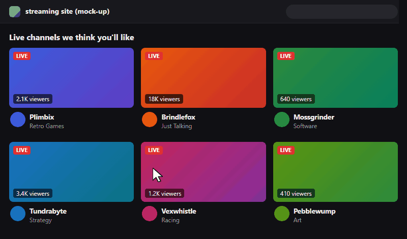
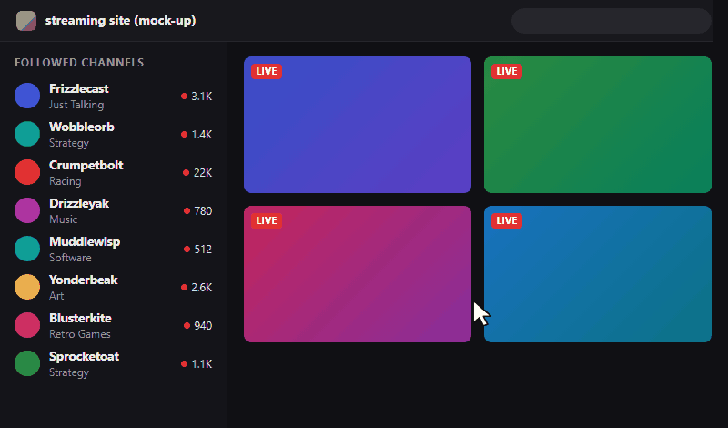
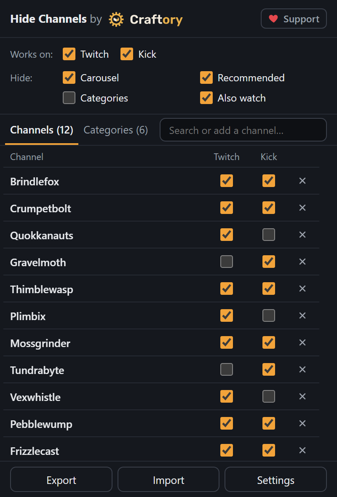

<p align="center">
  
</p>

<h1 align="center">Hide Channels for Twitch &amp; Kick</h1>

<p align="center">
  Hide the channels and categories you never want to see on Twitch and Kick.<br>
  In the directory, on the home page, in the sidebar, in search and in the featured carousel.
</p>

<p align="center">
  <a href="https://craftory.works">
    <picture>
      <source media="(prefers-color-scheme: dark)" srcset="docs/craftory-logo-on-dark.svg">
      
    </picture>
  </a>
</p>

<p align="center">
  
</p>

Unofficial, not affiliated with or endorsed by Twitch or Kick. The demo above uses a made-up streaming site.

## Features

- Hide a channel or a category with one click (the X on any tile, sidebar row or channel page).
- One list for both sites, with a per-site switch for every entry.
- Hide whole sections: the home page carousel, recommended channels, recommended categories, "viewers also watch".
- Hidden tiles can leave a neutral "Channel hidden" spot instead of disappearing, so the site does not keep loading more content forever.
- Export and import the list as a JSON file (for backups or moving to another browser).
- Everything stays in your browser: no account, no server, no analytics.
- Available in English, Polish, Spanish, Portuguese (Brazil), German, French, Italian, Turkish and Ukrainian.

Hiding from the sidebar works the same way: hover a row, click X, and the row is gone after a refresh.

<p align="center">
  
</p>

## Popup

<p align="center">
  
</p>

## Install

Store links will be added after publication (Chrome Web Store, Firefox Add-ons, Microsoft Edge Add-ons, Opera Add-ons).

Requirements: a current Chromium-based browser, or Firefox 140+ (Firefox for Android 142+).

## Privacy

The extension stores your list and settings only in your browser (`storage` permission) and never sends them anywhere: no account, no analytics, no tracking. Full policy: <https://craftory.works/hide-channels/privacy/>

## Disclaimer

This is an unofficial tool. It is not affiliated with, endorsed by or sponsored by Twitch Interactive, Inc. or Kick Streaming Pty Ltd. "Twitch" and "Kick" are trademarks of their respective owners and are used only to describe which websites the extension works on.

The extension is provided "as is", without warranty of any kind (see sections 15-17 of the [licence](LICENSE)). You use it at your own risk. The authors are not responsible for account suspensions or bans, or for how the websites behave. Twitch and Kick change their pages often; a change on their side can break hiding until the extension is updated.

## Known issues

- Kick "Categories for you" tiles carry only an English category name and no link, so they are matched by name. A category with a very different name on the two sites may not be hidden there.
- The mobile site `m.twitch.tv` is not supported yet.

## Development

Requires Node.js (LTS) and npm.

```sh
npm install          # also installs the git hooks (lefthook)
npm run dev          # Chrome with hot reload
npm run build        # .output/chrome-mv3
npm run build:firefox  # .output/firefox-mv3
npm run verify       # everything CI runs: biome, tsc, svelte-check, tests, build, web-ext lint
```

Stack: [WXT](https://wxt.dev), TypeScript, Svelte 5, Vitest, Biome. Manifest V3 on all browsers.

Project layout:

- `src/content` - the engine injected into Twitch and Kick pages
- `src/platforms/{twitch,kick}` - selectors and URL rules for each site
- `src/core` - data model, storage, matching
- `src/entrypoints` - popup, settings page, background, content script entries
- `src/locales` - translations (English is the source; tests check every language is complete)

Bug reports and ideas: [GitHub issues](https://github.com/craftoryworks/hide-channels/issues) or contact@craftory.works.

## Support

The extension is free. If you find it useful, you can support its development on [Ko-fi](https://ko-fi.com/craftory).

## Licence

[GPL-3.0](LICENSE)
